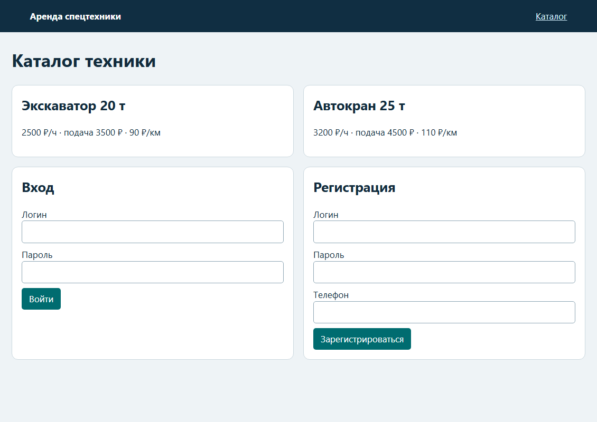
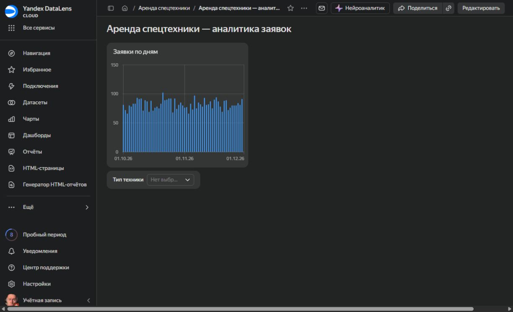

# Защищённая ИС аренды спецтехники

Курсовая работа по дисциплине «ТиМП». Flask и PostgreSQL обслуживают каталог экскаваторов и автокранов, заявки, расчёт логистики и хранение PDF-договоров с AES-256-GCM.

**Автор** — Помогаев Матвей Владимирович, группа ИБ-51Б.
**Университет** — Юго-Западный государственный университет, кафедра информационной безопасности.
**Руководитель** — Марухленко Анатолий Леонидович. Курск, 2026.

[Записка Word](docs/coursework.docx) · [Презентация](docs/presentation.pptx) · [Речь](docs/speech.txt) · [Дашборд DataLens](https://datalens.ru/p0viymkrrycs8-arenda-spectehniki-analitika-zayavok)

## Этапы по методичке

| Этап | Содержание | Материалы |
| --- | --- | --- |
| 1. Проектирование и архитектура | Требования, роли, ER-диаграмма, конфиденциальные поля, библиотеки | [Проектирование](docs/01-design.md) |
| 2. Базовый функционал | Установка, каталог, заявки, расчёт, 5000 строк, веб-клиент и аналитика | [Разработка](docs/02-development.md) |
| 3. Механизмы защиты | Argon2id, AES-GCM, сессии, роли, cookie и CSRF | [Защита](docs/03-security.md) |
| 4. Испытания | Сценарии S01–S20, Postman и снимки интерфейса | [Тестирование](docs/04-testing.md) |
| 5. Пояснительная записка | Три главы, схемы, листинги, иллюстрации и протокол | [Записка](docs/05-report.md) |
| 6. Материалы к защите | Девять слайдов, речь и порядок демонстрации | [Защита работы](docs/06-defense.md) |

Октябрь и ноябрь 2026 года заданы методичкой как плановые периоды этапов. Коммиты имеют фактические даты выполнения. Недельная история должна накапливаться по мере разработки.

## Функции

- Каталог экскаваторов и автокранов с тарифами.
- Регистрация клиента, вход и личный кабинет.
- Заявки с переходами new, accepted, closed и cancelled.
- Доставка по формуле подача + 2 × расстояние × ставка.
- Зашифрованные телефоны и PDF в PostgreSQL BYTEA.
- Проверка владельца при скачивании и журнал событий.
- Генератор 5000 синтетических заявок и интерактивная аналитика.



## Запуск в PowerShell

1. Создайте в PostgreSQL пустую базу rental и отдельного пользователя, которому разрешено создавать в ней таблицы.
2. Выполните в каталоге проекта `python -m venv .venv`. В PowerShell активируйте окружение через `.\.venv\Scripts\Activate.ps1`. Установите зависимости командой `python -m pip install -r requirements.txt`.
3. Скопируйте .env.example в .env. Укажите корректный DATABASE_URL. Для FLASK_SECRET выполните `python -c "import secrets; print(secrets.token_hex(32))"`. Для DATA_KEY выполните `python -c "import secrets,base64; print(base64.b64encode(secrets.token_bytes(32)).decode())"`. Сохраните полученные значения в .env. Для учебного запуска на 127.0.0.1 оставьте DEV_HTTP=1. Для HTTPS удалите эту переменную.
4. Выполните команды:

```text
python -m flask --app app init-db
python -m flask --app app seed
python -m flask --app app create-user operator staff
python -m flask --app app create-user auditor admin
python -m flask --app app run --host 127.0.0.1
```

5. Откройте http://127.0.0.1:5000 и зарегистрируйте клиента. Для ролей используйте отдельные профили браузера или выходите между входами. Создайте заявку на будущую дату, затем подтвердите её как operator. Прикрепите учебный PDF и проверьте скачивание под исходным клиентом. Аудит доступен под auditor.


## Испытания

В отдельной базе выполните init-db и seed, отключите DEV_HTTP и запустите python verify.py. Сценарий создаёт пользователей и умышленно портит тег своего тестового PDF. [Протокол](test-results.txt) содержит результаты прогона на PostgreSQL 18 от 6 ноября 2026 года. [Postman collection](postman.collection.json) предназначена для ручного воспроизведения.

## Аналитика

[Сохранённый дашборд Yandex DataLens](https://datalens.ru/p0viymkrrycs8-arenda-spectehniki-analitika-zayavok) содержит число заявок по дням и селектор типа техники. Его источник — файловая выгрузка агрегатов 5000 синтетических заявок. Доступ определяется правами воркбука.



Откройте dashboard.html локально для фильтров даты, статуса и техники, количества и сумм. Команда python export.py обновляет datalens.csv и dashboard.html. analytics.sql создаёт представление для отдельной роли datalens_reader.

## Состав проекта

| Путь | Назначение |
| --- | --- |
| app.py | Маршруты Flask, модели, расчёт, криптография и CLI |
| templates/ и static/ | Веб-интерфейс |
| requirements.txt, .env.example | Зависимости и образец конфигурации |
| verify.py, test-results.txt | Автоматические сценарии и протокол |
| postman.collection.json | Коллекция ручных проверок |
| export.py, analytics.sql, datalens.csv | Аналитическая витрина и экспорт |
| dashboard.html | Локальный дашборд |
| docs/ | Шесть этапов, диаграммы, Word, PowerPoint и речь |

## Границы прототипа

Сотрудник согласует доступность машины вручную. Расстояние вводится клиентом. Значения тарифов учебные, аналитическая выборка синтетическая. Суммы заявок отражают предварительные предложения. Рабочее размещение требует HTTPS, ограничения попыток входа, резервирования, ротации ключей и углублённого анализа PDF.

## Технологии

Python, Flask, Jinja, Flask-SQLAlchemy, psycopg2, PostgreSQL, argon2-cffi, cryptography, Flask-WTF, JavaScript и Yandex DataLens. Серверные сессии реализованы таблицей login_session и подписанным cookie Flask.

