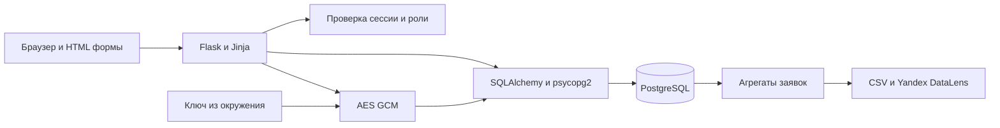
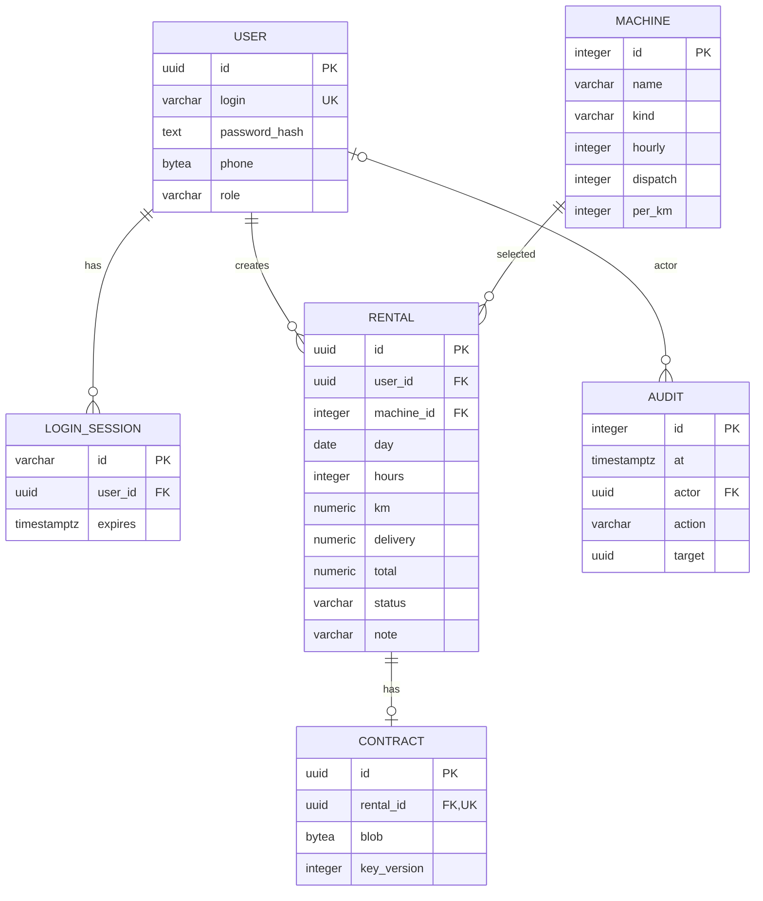

# Проектирование и архитектура

ИС предназначена для оформления аренды экскаваторов и автокранов, предварительного расчёта доставки и защищённой выдачи PDF-договоров.

## Матрица доступа

| Операция | Гость | Клиент | Сотрудник | Администратор |
| --- | --- | --- | --- | --- |
| Каталог | Да | Да | Да | Да |
| Создать заявку | Нет | Да | Нет | Нет |
| Читать заявку | Нет | Своя | Все | Нет |
| Отменить new | Нет | Своя | Все | Нет |
| Подтвердить и закрыть | Нет | Нет | Да | Нет |
| Загрузить PDF | Нет | Нет | Да | Нет |
| Скачать PDF | Нет | Своя | Все | Нет |
| Читать аудит | Нет | Нет | Нет | Да |

Роль при регистрации всегда client. Привилегированные аккаунты создаются CLI-командой create-user. При чтении объекта сервер проверяет роль и владельца.

## Архитектура

## ER диаграмма

Модели находятся в [app.py](../app.py). Схема ORM создаётся командой init-db. rental_id договора уникален. Цена сохраняется в NUMERIC(12,2), расстояние в NUMERIC(8,2). Классы User и LoginSession создают таблицы user и login_session.

## Конфиденциальные поля и инструменты

| Данные | Хранение | Инструмент |
| --- | --- | --- |
| Пароль | Хеш Argon2id с солью и параметрами | argon2-cffi |
| Телефон | AES-256-GCM, контекст связан с UUID пользователя | cryptography |
| PDF договора | BYTEA, nonce и шифротекст с тегом, AAD содержит UUID заявки и договора | cryptography |
| Сессия | Случайный SID, серверная таблица, срок два часа | Flask session и LoginSession |
| SQL | Параметризованные выражения ORM | Flask-SQLAlchemy |
| POST формы | CSRF-токены | Flask-WTF |

Пароль проверяется через verify. Восстановление телефона и договора требует отдельного ключа DATA_KEY.

