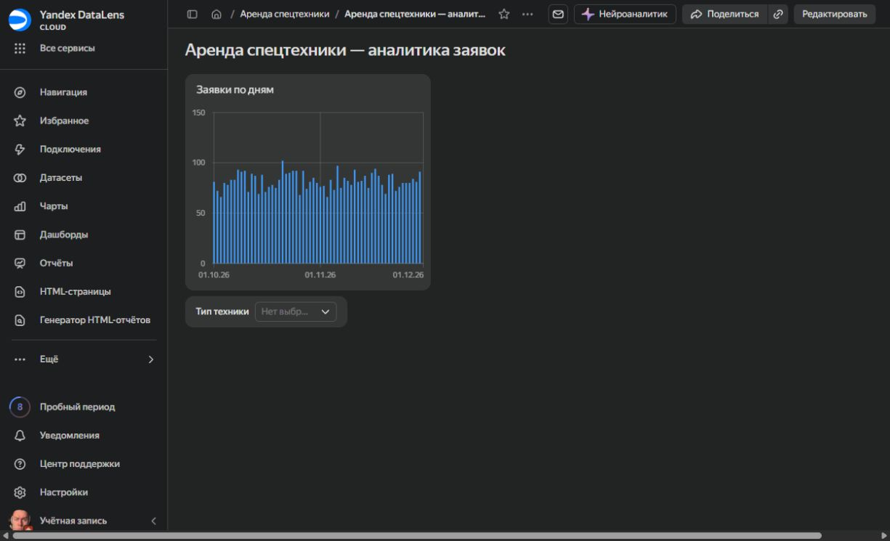
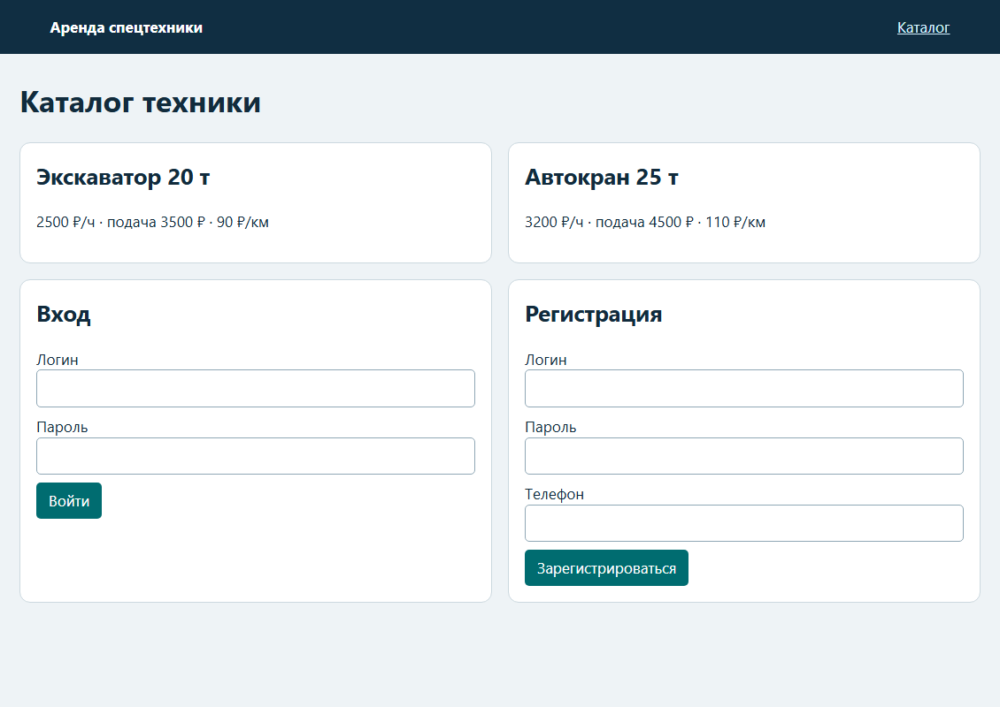

# Базовый функционал

Инструкция установки находится в [README](../README.md#запуск-в-powershell). Конфигурация задаётся в .env, пример состава полей находится в [.env.example](../.env.example).

## Пользовательские сценарии

1. Гость читает каталог и регистрируется.
2. Клиент входит и создаёт заявку на будущую дату.
3. Сервер рассчитывает доставку и стоимость.
4. Сотрудник подтверждает заявку и загружает PDF.
5. Владелец скачивает договор, сотрудник закрывает заявку.
6. Администратор просматривает события.

Состояния заявки — new, accepted, closed, cancelled. Отмена сохраняет строку для учёта истории. Клиент отменяет собственную новую заявку. Физическое удаление заказов интерфейсом не предусмотрено.

## Расчёт

Доставка = подача + 2 × расстояние в одну сторону × ставка за километр.

Итог = часы × ставка за час + доставка.

Экскаватор, 8 ч и 25 км дают доставку 8 000 ₽ и итог 28 000 ₽. Значения проверяются сервером, расчёт использует Decimal.

## Данные и аналитика

Команда seed добавляет ровно 5000 строк rental техническому пользователю. Проверка наличия пользователя предотвращает повторную загрузку при последовательном запуске. Выборка синтетическая, seed=42 используется для характеристик заявок.

[Открыть DataLens](https://datalens.ru/p0viymkrrycs8-arenda-spectehniki-analitika-zayavok).

В DataLens загружена агрегированная CSV-выгрузка этих 5000 заявок. График показывает SUM(orders) по day, селектор работает по kind. Локальный [dashboard.html](../dashboard.html) дополнительно показывает суммы. [export.py](../export.py) обновляет CSV и локальный HTML. [analytics.sql](../analytics.sql) создаёт витрину для отдельной роли чтения.

## Интерфейс

Шаблон находится в templates/page.html, стили в static/style.css. В списке выводится 50 заявок на страницу. Позиции каталога обозначают типовые предложения, доступность конкретной машины согласует сотрудник.

