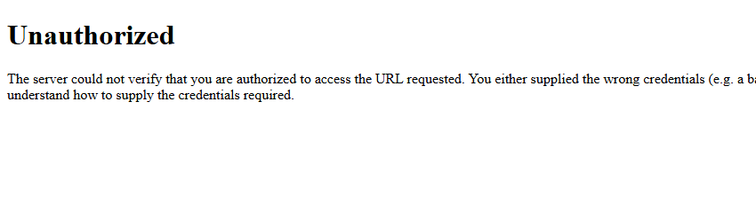

# Тестирование функций и защищённости

Фактический протокол запуска на PostgreSQL 18 находится в [test-results.txt](../test-results.txt). Проверки выполнялись 6 ноября 2026 года через тестовый клиент Flask и реальную отдельную базу PostgreSQL. В сценарии S01 подтверждено 5000 синтетических заявок. Коды S01–S20 обозначают 20 сценариев, часть запускается для нескольких аккаунтов.

## Повторный запуск

Используйте отдельную тестовую базу. Задайте её DATABASE_URL и секреты через окружение, выполните init-db и seed. Отключите DEV_HTTP для проверки флагов cookie, затем запустите python verify.py. Сценарий создаёт тестовые аккаунты и изменяет тег своего тестового договора.

| Проверка | Ожидаемый результат |
| --- | --- |
| Гость открывает кабинет | 401 |
| SQL-фрагмент в логине | 401 |
| POST без CSRF | 400 |
| XSS в комментарии | Экранированный HTML |
| Чужая карточка | 404 |
| Чужой договор | 404 |
| Клиент открывает аудит | 403 |
| Расчёт экскаватора 8 ч, 25 км | 8000 и 28000 ₽ |
| Загрузка сотрудником | 302 |
| Скачивание владельцем | Побайтное совпадение |
| pg_typeof поля договора | bytea |
| Изменение тега | 503 |
| Аудит | rental_denied и contract_invalid |
| Выход | Следующий запрос 401 |

## Ручная проверка

Импортируйте [Postman collection](../postman.collection.json), задайте base, login, password, day и rental_id. Первый GET получает cookie и CSRF. После входа обновите токен повторным GET. В коллекции отключено следование перенаправлениям. Чужие ссылки проверяются в отдельной сессии. Коллекция подготовлена для ручного запуска, результаты автоматического прогона приведены отдельно.

В браузере можно показать каталог, заказ, подтверждение, загрузку и скачивание. Снимок ниже фиксирует отказ гостю при GET /rentals.

Расширение тестов на все числовые границы, большие файлы, нагрузку и конфигурацию TLS требует отдельного прогона.

